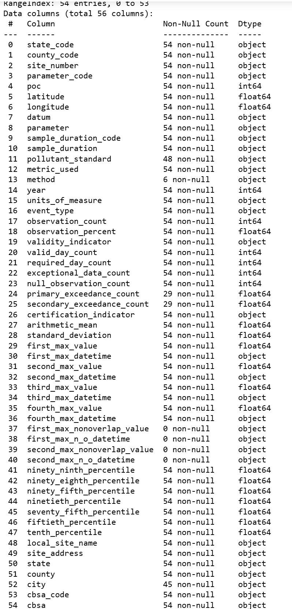
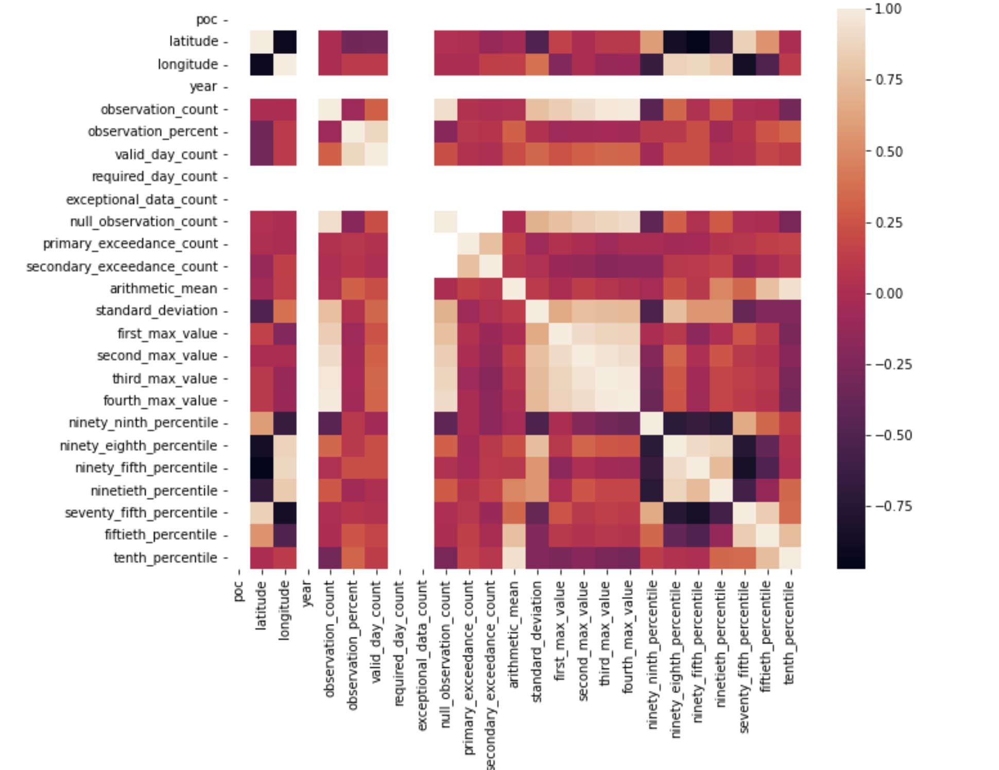

# Getting Started - Python

## Set up Environment Variables

> [!IMPORTANT]
> Update the **.env.template** file with the details generated from registering for API access, `API_KEY` & `API_EMAIL`. Save the updated file as .env (remove the .template).

## Install Dependencies

> [!NOTE]
> Using a virtual environment is recommended!

In the desired environment, run `pip install -r requirements.txt` to install the required dependencies.

## Run the Dashboard

`dash-app.py` is the full dashboard with the natural-language chart builder (the version deployed to PythonAnywhere). It needs a [Gemini API key](https://aistudio.google.com/apikey) and a data source.

The quickest setup uses SQLite and the bundled sample data. Create `python/.env` with just these two lines. Leave out the template's empty variables, because an empty value (for example `SQLITE_TABLE_NAME=`) overrides the default.

```bash
GEMINI_API_KEY=your-key
DB_CONNECTION_TYPE=sqlite
```

Load the sample data into `epa_aqs_data.db` (once), then start the app from the `python` directory:

```bash
python -c "import sqlalchemy as sa, utils; e = sa.create_engine('sqlite:///epa_aqs_data.db'); utils.initialize_db_data(e, sa.inspect, 'air_quality', 'data/combined_data_20251006.csv', 'sqlite')"
python dash-app.py
```

Other data sources are selected with `DB_CONNECTION_TYPE`: `mysql`, `cloud_sql` (PostgreSQL through the Cloud SQL connector) or `github_raw`. See `.env.template` for the variables each one reads.

`app.py` is an earlier, simpler dashboard that reads the sample CSV directly and needs no API key: `python app.py`.

By default, the app will run locally at <http://127.0.0.1:8050/>

## Run the Tests

```bash
pip install pytest
pytest
```

The tests use a fake chat model, so they need no API key.

NOTE: The sample data, `air_quality_data.json`, is pulled from the following date range 2019-01-01 to 2019-12-31 with California and Alameda County as the respective State and County filters.

## Troubleshooting

### Check if API is Available

| Service | Filter | Endpoint   | Required Variables | Optional Variables |
|---------|--------|------------|--------------------|--------------------|
|  | Is the API available for use? | metaData/isAvailable |  | email, key |

**Example:** To check if the API is up and running: <https://aqs.epa.gov/data/api/metaData/isAvailable>

### Request Limits and Terms of Service

> [!IMPORTANT]
> The API has the following limits imposed on request size:
>
> - **Length of time**. All services (except Monitor) must have the end date (edate field) be  in the same year as the begin date (bdate field).
> - **Number of parameters**. Most services allow for the selection of multiple parameter codes (param field). A maximum of 5 parameter codes may be listed in a single request.
>
> Please adhere to the following when using the API.
>
> - **Limit the size of queries**. Our database contains billions of values and you may request more than you intend. If you are unsure of the amount of data, start small and work your way up. We request that you limit queries to 1,000,000 rows of data each. You can use the "observation count" field on the annualData service to determine how much data exists for a time-parameter-geography combination. If you have any questions or need advice, please contact us.
> - **Limit the frequency of queries**. Our system can process a limited load. If scripting requests, please wait for one request to complete before submitting another and do not make more than 10 requests per minute. Also, we request a pause of 5 seconds between requests and adjust accordingly for response time and size.
>
> If you violate these terms, we may disable your account without notice (but we will be in contact via the email address provided).

## Exploratory Data Analysis (EDA)

A Juypter Notebook is available to explore within the `assets` directory.

### Columns Available Within the Sample Dataset



### Heatmap of Correlation Between Variables Within the Sample Dataset


