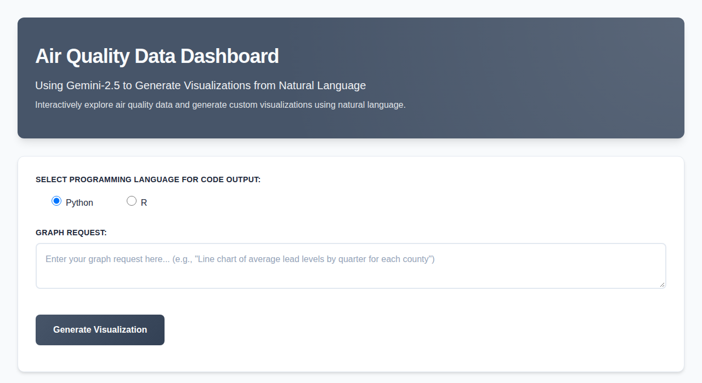
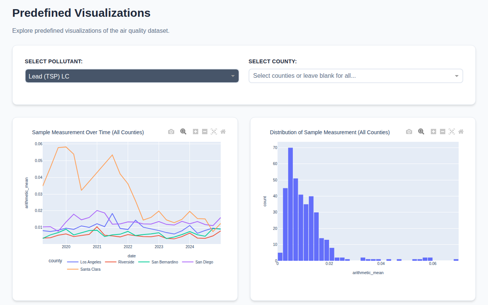

# EPA Air Quality Dashboard

[](https://github.com/djbrownbear/epa-aqs-project/actions/workflows/ci.yml)

An interactive dashboard for U.S. EPA air quality data, with a natural-language chart builder powered by Gemini. Ask for a chart in plain English, get an interactive Plotly figure plus the Python or R code that reproduces it.

**Live demo:** <https://djbrownbear.pythonanywhere.com>





## Features

- **Natural-language charts.** Describe a chart ("Line chart of average lead levels by quarter for each county") and choose Python or R. Gemini turns the request into a chart spec, and the app draws the chart and shows the equivalent code.
- **Predefined visualizations.** Filter by pollutant and county to see measurements over time, their distribution, and a map of monitoring sites.
- **EPA AQS API tooling.** Scripts in Python and R pull data from the [EPA Air Quality System (AQS) API](https://aqs.epa.gov/aqsweb/documents/data_api.html) and combine reports into the dataset the dashboard uses.
- **Pluggable data source.** The app reads from SQLite, MySQL, Google Cloud SQL (PostgreSQL), or CSVs on GitHub, chosen with one environment variable.

## How the AI chart builder works

```text
user request ──► input checks ──► Gemini (structured output) ──► ChartSpec
                                                                   │
                                     validate against the dataframe ┤
                                                                   ▼
                          Plotly figure  +  generated Python / R code
```

The model never writes code that the app runs. It fills in a `ChartSpec` (chart type, columns, aggregate, filters, title) through LangChain's structured output. [`python/chart_spec.py`](python/chart_spec.py) validates the spec against the real columns and values, builds the figure with `plotly.express`, and generates the code shown to the user from the same spec. A bad or adversarial request can at worst produce an error message or an odd chart. Tests check that the generated Python reproduces the same figure.

## Tech stack

| Area | Tools |
|------|-------|
| App | Python, Dash, Plotly |
| AI | Gemini 2.5 Flash via LangChain (`langchain-google-genai`), Pydantic structured output |
| Data | pandas, SQLAlchemy, SQLite / MySQL / Cloud SQL (PostgreSQL) |
| Data collection | EPA AQS API, Python `requests`, R (`RAQSAPI`) |
| Hosting | PythonAnywhere |
| Testing | pytest |

## Run it locally

```bash
cd python
python -m venv .venv && source .venv/bin/activate
pip install -r requirements.txt pytest
printf 'GEMINI_API_KEY=your-key\nDB_CONNECTION_TYPE=sqlite\n' > .env
```

Then load the sample data and start the app. Full steps are in the [Python guide](python/readme.md).

```bash
python -c "import sqlalchemy as sa, utils; e = sa.create_engine('sqlite:///epa_aqs_data.db'); utils.initialize_db_data(e, sa.inspect, 'air_quality', 'data/combined_data_20251006.csv', 'sqlite')"
python dash-app.py      # http://127.0.0.1:8050
pytest
```

## Project structure

```text
python/
  dash-app.py        Dashboard + AI chart builder (the deployed app)
  chart_spec.py      ChartSpec schema, validation, figure and code generation
  utils.py           Data loading, DB engines, input checks
  main.py            Interactive EPA AQS API client
  app.py             Earlier, simpler dashboard
  data/              Sample dataset (5 California counties, 2019–2024)
  tests/
R/                   R client for the AQS API (RAQSAPI)
scripts/             Combine downloaded reports into one CSV/JSON
assets/              EPA AQS API reference notes, EDA notebooks, sample API responses, images
```

## Data source

Data comes from the U.S. EPA [Air Quality System (AQS) API](https://aqs.epa.gov/aqsweb/documents/data_api.html). To pull your own data you need a free API key. See [assets/epa-aqs-api.md](assets/epa-aqs-api.md) for sign-up, sample responses, request limits and EDA notes, and [`prompt.md`](prompt.md) for the prompts used while building the API client.
